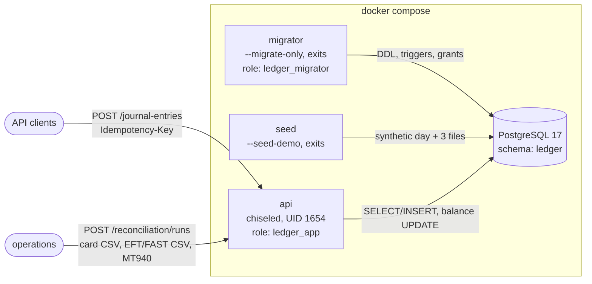
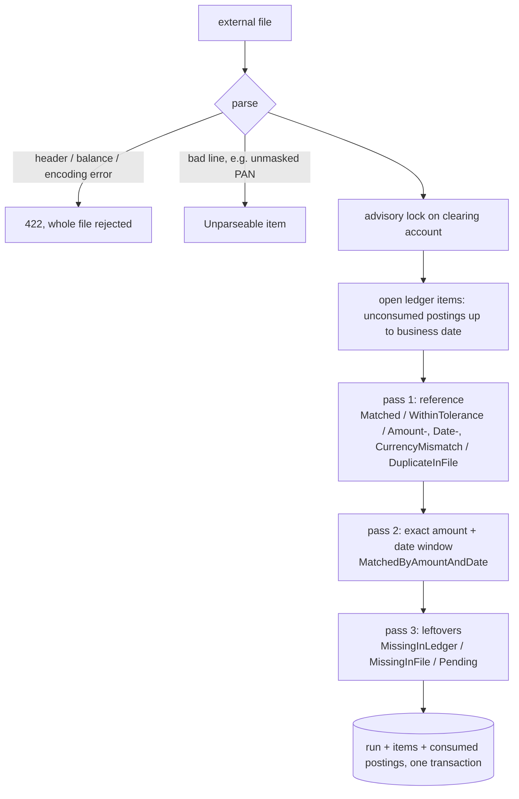

# ledger-recon

[](https://github.com/hekimcan206/ledger-recon/actions/workflows/ci.yml)
[](https://github.com/hekimcan206/ledger-recon/actions/workflows/codeql.yml)


[](LICENSE)

A double-entry ledger and reconciliation engine. A re-sent transaction is never processed a second time
(exactly-once flow). At end of day the ledger is matched against card, EFT and correspondent-bank files, and the
result is a difference list. The design rests on transaction isolation and lock management. Built with PostgreSQL
and .NET 10.

> All data is synthetic; no real personal, card or bank data. Card numbers are masked test patterns, and IBANs,
> names and references are generated.

## Problem

Payment systems get two things wrong more often than anything else:

1. **Double processing.** A client times out and retries, a broker redelivers, a user taps twice. If the server
   already committed the first attempt, the retry moves the money again.
2. **Silent drift from the outside world.** The ledger says the card sale happened. The acquirer's settlement
   file, the central bank's EFT/FAST report or the correspondent bank's statement may disagree: an item is
   missing, the amount is off by deducted charges, a reference is truncated, a line appears twice. Finding these
   differences every day is reconciliation.

Under concurrency both problems get worse: two retries arrive at the same millisecond, two transfers lock the
same accounts in opposite order, and a hot settlement account is written by everyone at once.

## Solution

| Concern | How |
|---|---|
| Double entry | Integer minor units; an entry exists only if debits = credits. The database re-checks this at COMMIT with a **deferred constraint trigger**, so raw SQL cannot break it either |
| Exactly once | `Idempotency-Key` header + SHA-256 request fingerprint. The **unique index is the arbiter**: the key is claimed with `INSERT ... ON CONFLICT DO NOTHING` in the same transaction as the effects. Same key and payload → original entry (`Idempotent-Replayed: true`); same key, different payload → `422` |
| Concurrent balance updates | READ COMMITTED + `SELECT ... FOR UPDATE` on touched accounts **in ascending id order** (no deadlocks), overdraft checked on the locked row, `lock_timeout` → retryable `503`. SERIALIZABLE (SSI + retry) is implemented as a switchable alternative and measured |
| Immutable history | Append-only triggers (even the schema owner gets `23001`) and a DML-only application role without UPDATE/DELETE (`42501`) |
| Reconciliation | Parsers for an acquirer card CSV, an EFT/FAST CSV and an MT940 subset. Three matching passes (reference → amount + date fallback → leftovers) with per-source tolerance and date window. **Open-item** model with pending carry-over. Difference report as JSON or CSV |
| Concurrent reconciliation | `pg_advisory_xact_lock` per clearing account: runs are serialised without blocking postings to that account. Same file + day → the existing run |
| Proof | FsCheck properties (in memory and against PostgreSQL), concurrent-duplicate tests via Testcontainers, golden report tests, NBomber load test with measured TPS and percentiles |

## Architecture



Posting one entry ([ADR 0002](docs/adr/0002-exactly-once-posting-and-lock-strategy.md)):

```mermaid
sequenceDiagram
    participant C as Client
    participant S as PostingService
    participant DB as PostgreSQL (READ COMMITTED)
    C->>S: POST entry, Idempotency-Key: K
    S->>S: validate (debits = credits), fingerprint H
    S->>DB: BEGIN; INSERT journal_entries (K, H) ON CONFLICT DO NOTHING
    alt K already committed
        DB-->>S: no row
        S->>DB: SELECT hash WHERE key = K; ROLLBACK
        S-->>C: same H → 201 original entry (Idempotent-Replayed: true)<br/>other H → 422 idempotency.key_reused
    else K being inserted by a concurrent request
        Note over DB: blocks on the uncommitted index entry,<br/>then sees the row (replay) or proceeds (first one rolled back)
    else K claimed
        S->>DB: SELECT accounts WHERE code = ANY(..) ORDER BY id FOR UPDATE
        S->>S: currency + overdraft rules on locked rows
        S->>DB: UPDATE balances; INSERT postings (one batch)
        S->>DB: COMMIT (deferred trigger: entry balances?)
        S-->>C: 201 entry (Idempotent-Replayed: false)
    end
```

Reconciliation ([ADR 0003](docs/adr/0003-end-of-day-reconciliation.md)):



## Why this design

- **The database guards the invariants, not just the code.** Balanced entries, currency consistency, append-only
  history, overdraft limits and key uniqueness are all enforced by PostgreSQL. `DatabaseInvariantTests` breaks
  each one with raw SQL and expects the exact SQLSTATE. ([ADR 0001](docs/adr/0001-double-entry-model-enforced-in-postgresql.md))
- **The unique index arbitrates duplicates**, not an advisory lock or a check-then-insert. The claim and the
  effects commit or vanish together, so a crash can never leave a key that is claimed but not applied.
- **Row locks over SSI, by measurement.** At 32 concurrent clients, RowLocks sustained 1 185 posts/s with zero
  failures. SERIALIZABLE managed 523/s and returned retryable 503s, even on a low-contention workload. See
  [benchmarks](docs/benchmarks.md). Lock ordering by account id makes deadlocks impossible by construction.
- **Rejections release the key.** An insufficient-funds rejection rolls back the claim, so the same request can
  succeed after a deposit. This differs from Stripe on purpose: in a ledger, a request that failed a business
  rule did not happen.
- **Reconciliation is a pure function**, which is why it can be property-tested: the synthetic generator records
  every defect it injects, and the engine must report exactly those, for any seed.
- **The advisory lock protects reconciliation runs, not the clearing account row.** Locking the row would stop
  card postings for the length of every run.
- **Plain SQL and Npgsql, no ORM**, because the correctness lives in the SQL. ([ADR 0004](docs/adr/0004-plain-sql-npgsql-and-least-privilege.md))

## Quick start

Requirements: Docker. (.NET SDK 10.0.400+ for tests and the load test.)

```bash
docker compose up --build
```

This starts PostgreSQL with least-privilege roles, applies migrations, seeds one synthetic business day
(258 entries) and reconciles the three generated files. Then:

```bash
curl -s localhost:58180/api/v1/ledger/trial-balance
# {"balanced":true,"driftingAccounts":0,"currencies":[{"currency":"TRY",...,"net":0,...},{"currency":"USD",...,"net":0,...}]}

curl -s localhost:58180/api/v1/reconciliation/runs          # three runs: Card, Eft, Correspondent
```

Open <http://localhost:58180/scalar> for the API reference. To try exactly-once by hand, send the same request
twice, then change the amount:

```bash
post() { curl -s -i -X POST localhost:58180/api/v1/journal-entries -H 'content-type: application/json' \
  -H 'Idempotency-Key: demo-123' -d "{\"description\":\"t\",\"currency\":\"TRY\",\"lines\":[
  {\"accountCode\":\"VAULT_TRY\",\"direction\":\"debit\",\"amount\":$1},
  {\"accountCode\":\"CUST_TRY_0001\",\"direction\":\"credit\",\"amount\":$1}]}" | grep -E '^HTTP|Replayed|code'; }
post 10.50   # HTTP/1.1 201 Created, Idempotent-Replayed: false
post 10.50   # HTTP/1.1 201 Created, Idempotent-Replayed: true   (nothing written)
post 11.00   # HTTP/1.1 422 ... "code":"idempotency.key_reused"
```

Reconcile a file yourself (the samples are in [`samples/`](samples)):

```bash
curl -s -X POST "localhost:58180/api/v1/reconciliation/runs?source=correspondent&businessDate=2026-11-05" \
     --data-binary @samples/correspondent-usd-2026-11-05.sta     # 200: same file as the seed → existing run
```

Output from the seeded demo (correspondent bank, MT940):

```text
GET /api/v1/reconciliation/runs/{id}
{"source":"Correspondent","accountCode":"NOSTRO_USD","recordCount":79,"ledgerItemCount":80,"matchedCount":66,
 "differenceCount":14,"pendingCount":5,"kinds":{"Matched":61,"MatchedWithinTolerance":1,"MatchedByAmountAndDate":4,
 "AmountMismatch":3,"DateMismatch":5,"MissingInLedger":4,"MissingInFile":1,"DuplicateInFile":1,"Pending":5}}

GET /api/v1/reconciliation/runs/{id}/items?differencesOnly=true&format=csv
kind,line,file_reference,file_date,file_amount,posting_id,entry_id,ledger_reference,ledger_value_date,ledger_amount,difference,currency,detail
MissingInLedger,13,W261105128733092,2026-11-03,443383.14,,,,,,443383.14,USD,No ledger posting with this reference or amount.
DateMismatch,19,W261105035964396,2026-11-02,-284482.46,458,…,W261105035964396-USD,2026-11-05,-284482.46,0.00,USD,"File date 2026-11-02, ledger value date 2026-11-05 (3 days apart, window 2)."
AmountMismatch,25,W261105331515247,2026-11-05,423608.98,473,…,W261105331515247-USD,2026-11-05,423484.77,124.21,USD,"File 423608.98, ledger 423484.77."
```

Run the tests (Docker must be running; the integration tests start PostgreSQL through Testcontainers):

```bash
dotnet test
```

Regenerate synthetic files: `dotnet run --project tools/LedgerRecon.FileGen -- --seed 42 --date 2026-11-05 --out my-files`.

## API

| Method | Path | Notes |
|---|---|---|
| POST | `/api/v1/accounts` | `{code, name, type: asset\|liability\|equity\|revenue\|expense, currency: TRY\|USD\|EUR, preventOverdraft}`. Identical re-create → 200, conflicting → 409 |
| GET | `/api/v1/accounts/{code}`, `/api/v1/accounts?prefix=` | balance (signed, debit-positive) and normal-side balance |
| POST | `/api/v1/journal-entries` | requires `Idempotency-Key`; 201, replay 201 + `Idempotent-Replayed: true`, 400 validation, 422 rule or key reuse, 503 busy |
| GET | `/api/v1/journal-entries/{id}` | entry with postings |
| GET | `/api/v1/ledger/trial-balance` | per-currency net (must be 0) and drift count (must be 0) |
| POST | `/api/v1/reconciliation/runs?source=&businessDate=&account=` | body = raw file; 201 new run, 200 same file again, 422 invalid file |
| GET | `/api/v1/reconciliation/runs[/{id}[/items?differencesOnly=&format=csv]]` | runs and difference reports |

Errors are RFC 9457 problem details with a stable `code` (for example `entry.unbalanced`,
`account.insufficient_funds`, `idempotency.key_reused`, `file.statement_does_not_balance`) and a `traceId`.

## Results (measured)

Details, method and environment are in [docs/benchmarks.md](docs/benchmarks.md) (laptop, i7-13620H, Docker
Desktop, with other workloads running).

| What | Result |
|---|---|
| Tests | 121 passing: 78 unit (incl. FsCheck: 500 cases per ledger property, 200 generated days per reconciliation property, golden reports) + 43 integration against PostgreSQL 17 via Testcontainers |
| 50 identical concurrent requests | exactly 1 journal entry and 2 postings, 49 replays; both strategies |
| 50 concurrent withdrawals, funds for 20 | RowLocks: exactly 20 × 201 and 30 × 422; the protected balance never goes negative under either strategy |
| 40 opposing A↔B transfers | no deadlock, balances conserved |
| Reconciliation property | engine reports exactly the injected defects (multiset equality) for every generated day |
| Posting throughput, 32 clients, low contention | **1 185 RPS**, p50 22.6 ms, p95 48.0 ms, p99 75.9 ms (RowLocks) vs 523 RPS with SERIALIZABLE |
| One hot account, 32 clients | 182 RPS, 0 failures, p99 1.39 s (RowLocks) vs 172 RPS with 11% retryable 503s (SERIALIZABLE) |
| Idempotent replay | 2 000 RPS, p99 34.8 ms |
| `docker compose up` (built) → ready + demo seeded | 17.7 s; re-running the seed posts 0 and replays 258 |
| Runtime image | 194 MB, chiseled, non-root |

## Prior art and comparison with Blnk

| | **ledger-recon** | [Blnk](https://github.com/blnkfinance/blnk) | TigerBeetle | Modern Treasury Ledgers |
|---|---|---|---|---|
| What it is | portfolio-sized service showing the mechanics | open-source ledger + reconciliation server (Go, PostgreSQL) | purpose-built financial database | hosted ledger API |
| Duplicate protection | `Idempotency-Key` + request hash, unique index claimed in-transaction; mismatch → 422 | unique transaction `reference` per transaction | the transfer `id` is the idempotency key | idempotency keys at the API |
| Balance model | signed running balance per account, append-only postings | balances with separate inflight (held) amounts | `debits_posted` / `credits_posted` totals (+ pending) | balances with `lock_version` |
| Concurrency | ordered row locks (default) or SSI + retry, both measured | handled inside the server | single-threaded state machine, batched | optimistic locking with `lock_version` |
| Holds / two-phase | not implemented | inflight transactions (commit / void / expiry) | pending transfers (post / void / timeout) | pending entries |
| Reconciliation | card CSV, EFT/FAST CSV, MT940 subset; reference → amount+date passes, tolerance, open items | built-in reconciliation with matching rules against uploaded external data | out of scope | out of scope (product-level) |
| Where invariants are enforced | in PostgreSQL itself: deferred balance trigger, currency FKs, append-only triggers, overdraft CHECK | in the Blnk server | in the database engine | in the hosted service |

What this repository borrows: TigerBeetle's "the id *is* the idempotency key" (here the idempotency key is a
column of the entry itself), Blnk's idea that ledger and reconciliation belong together, and Modern Treasury's
public write-ups on concurrency control. Its focus differs: the hard parts (exactly-once under concurrency, lock
strategy, database-enforced invariants, deterministic matching) are kept small enough to read in one sitting and
are proven by tests and measurements. It is not a replacement for any of these products.

## Limitations and next steps

- **No authentication or authorisation.** Required before any real use (mTLS or OAuth2 client credentials, with
  scopes for post, read and reconcile), together with recording the caller on each entry. See the
  [threat model](docs/threat-model.md).
- **Hot-account ceiling** of about 180 transfers/s per account on this hardware. Next: batch transfers per
  transaction, or split hot accounts into sub-accounts that are summed on read.
- No holds or two-phase transfers (authorisation → capture/void), and no FX: an entry has one currency.
- Reconciliation matches one-to-one. Card payouts that settle many sales (many-to-one), fees and an operator
  workflow to resolve or confirm differences (with an audit trail) are not implemented.
- File formats are realistic but synthetic. The MT940 support is a single-statement subset; CAMT.053, BKM/acquirer
  native formats and real TCMB EFT/FAST layouts are out of scope.
- Idempotency keys never expire (they are part of the entry). Expiry policies need a separate key store.
- The benchmark is a single-machine laptop measurement with background load, not a capacity claim.

## Privacy note (KVKK / GDPR)

KVKK is Turkey's Personal Data Protection Law (*Kişisel Verilerin Korunması Kanunu*), similar to the GDPR. All data
in this repository is synthetic. Reconciliation needs neither counterparty names nor IBANs, so the EFT parser reads
them for validation only and never stores them (data minimisation). A card line that carries a full card number is
rejected, and the number is neither stored nor echoed in the report (PCI DSS). Request bodies are not logged.

## License

[MIT](LICENSE)
